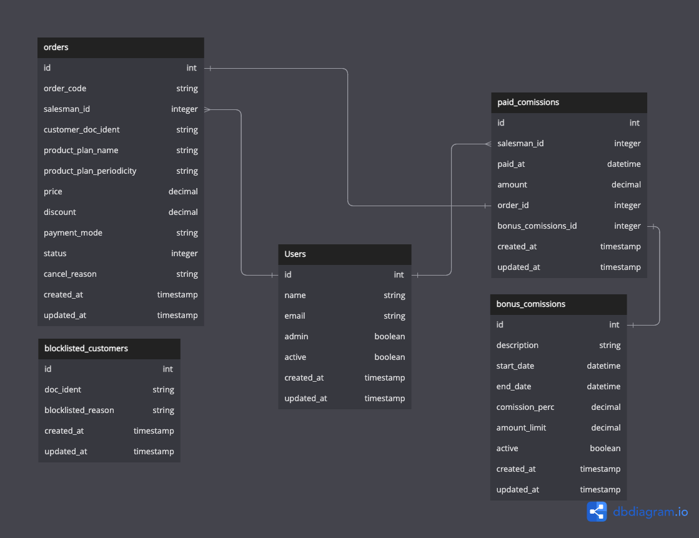

# 🛒 Sistema de Checkout - Gestão de Pedidos e Vendas

> Projeto desenvolvido como trabalho de conclusão (saída) do treinamento **Quero Ser Dev 40+** da **[Campus Code](https://www.campuscode.com.br/)**, em parceria com a **[Locaweb](https://www.locaweb.com.br/)**.

---

## 📌 Sobre o Projeto

O **Checkout** é uma aplicação web desenvolvida em **Ruby on Rails** voltada para a gestão do fluxo de vendas, pedidos e comissões da Locaweb. O sistema atua como ponto central de checkout dentro de uma arquitetura de serviços integrados, comunicando-se com serviços externos de **Catálogo de Produtos** e **Cadastro de Clientes**, além de fornecer uma **API REST** para atualização de status, aplicação de descontos, pagamentos e renovações de planos.

### 🎯 Principais Objetivos
- Proporcionar um fluxo assistido (wizard multi-etapas) para vendedores criarem pedidos com validação de dados em tempo real.
- Integrar com serviços externos para obtenção de produtos/planos/preços e validação cadastral de clientes (CPF/CNPJ).
- Gerenciar o ciclo de vida dos pedidos (`pending`, `awaiting_payment`, `paid` e `cancelled`).
- Automatizar o cálculo de comissões de vendedores com suporte a campanhas de incentivo/bonificação.
- Controlar lista de bloqueio de clientes (blocklist).
- Apresentar indicadores gerenciais de vendas por meio de um dashboard com gráficos analíticos.

---

## 🚀 Funcionalidades

### 🔐 Autenticação e Perfis de Acesso
- Autenticação gerenciada via **Devise**.
- Restrição institucional de e-mail (apenas contas com domínio `@locaweb.com.br`).
- Perfis de usuário:
  - **Administrador**: Gestão de vendedores, configuração de campanhas de bonificação, controle de lista de bloqueio de clientes e visualização de relatórios consolidados de comissões.
  - **Vendedor**: Criação de pedidos, consulta aos seus pedidos e acompanhamento de metas.
- Gerenciamento de vendedores: ativação/desativação, bloqueio preventivo e redefinição de senhas.

### 📝 Fluxo de Criação de Pedido (Checkout Wizard)
Processo dividido em etapas guiadas com validações automáticas:
1. **Identificação do Cliente**: Validação formal de CPF ou CNPJ (dígitos verificadores) e checagem preventiva na lista de clientes bloqueados (*blocklist*).
2. **Dados Cadastrais**: Consulta automática via API externa de clientes. Caso o cliente ainda não esteja cadastrado, um formulário completo é exibido para cadastro imediato.
3. **Grupo de Produtos**: Seleção da categoria de produtos (ex.: Hospedagem de Sites, Email Locaweb, Criador de Sites) carregada dinamicamente via API de Produtos.
4. **Planos**: Escolha do plano específico associado ao grupo selecionado.
5. **Periodicidade e Preço**: Definição da frequência de faturamento (Mensal, Trimestral, Anual) e preço correspondente.
6. **Confirmação e Geração**: Revisão dos dados e finalização do pedido, gerando um código único alfanumérico de 10 caracteres (ex.: `GPQJU3FPN5`).

### 📦 Gestão de Pedidos
- Listagem geral paginada (Kaminari) de pedidos.
- Filtros por status do pedido:
  - `pending` (Pendente)
  - `awaiting_payment` (Aguardando Pagamento)
  - `paid` (Pago)
  - `cancelled` (Cancelado)
- Visualização detalhada de pedidos com histórico e dados completos.
- Cancelamento de pedidos com exigência de justificativa.
- Renovação de pedidos pagos (com verificação do plano ativo e obtenção do preço atualizado via API).

### 💰 Comissões e Campanhas de Bônus
- **Comissão Padrão**: Percentual base configurável (definido em `config/commissions.yml`).
- **Campanhas de Bonificação**:
  - Cadastro de períodos promocionais com percentual diferenciado de comissão e limite máximo de bonificação por vendedor.
  - Vinculação e cálculo automático da comissão no instante em que o pedido é marcado como pago (`paid`).
- **Relatório de Comissões**:
  - Visão detalhada e agrupada das comissões pagas por vendedor.
  - Filtro por nome do vendedor e intervalo de datas.

### 🚫 Bloqueio de Clientes (Blocklist)
- Cadastro de CPF/CNPJ de clientes impedidos de realizar novas contratações.
- Registro obrigatório do motivo do bloqueio (ex.: processo judicial, suspeita de fraude, pendência contratual).
- Bloqueio imediato na primeira etapa do checkout e opção de desbloqueio por administradores.

### 📊 Dashboard Analítico
- Métricas e visualizações interativas com **Chartkick** e **Chart.js**:
  - Distribuição de pedidos por status.
  - Pedidos por grupo de produto.
  - Vendas por tipo de periodicidade.
  - Volume de vendas por vendedor.
- Filtros interativos por período e por vendedor.

---

## 🛠️ Tecnologias Utilizadas

- **Linguagem:** [Ruby 3.2.0](https://www.ruby-lang.org/)
- **Framework Web:** [Ruby on Rails 7.0.4](https://rubyonrails.org/)
- **Banco de Dados:** SQLite3
- **Frontend & Estilo:**
  - [LocaStyle](https://assets.locaweb.com.br/locastyle/) (Design System da Locaweb)
  - [Chartkick](https://chartkick.com/) & [Chart.js](https://www.chartjs.org/)
  - [esbuild](https://esbuild.github.io/) / [jsbundling-rails](https://github.com/rails/jsbundling-rails)
- **Autenticação:** [Devise](https://github.com/heartcombo/devise)
- **Requisições HTTP:** [Faraday](https://github.com/lostisland/faraday)
- **Utilitários:** [cpf_cnpj](https://github.com/fnando/cpf_cnpj), [kaminari](https://github.com/kaminari/kaminari)
- **Testes & Qualidade:**
  - [RSpec Rails](https://github.com/rspec/rspec-rails)
  - [Capybara](https://github.com/teamcapybara/capybara) & [Cuprite](https://github.com/rubycdp/cuprite)
  - [FactoryBot Rails](https://github.com/thoughtbot/factory_bot_rails)
  - [SimpleCov](https://github.com/simplecov-ruby/simplecov)
  - [RuboCop](https://github.com/rubocop/rubocop) & [RuboCop Rails](https://github.com/rubocop/rubocop-rails)

---

## 🗄️ Modelo de Dados

O diagrama abaixo apresenta o modelo relacional da aplicação:

<p align="center">
  
</p>

### Principais Entidades:
- **`users`**: Vendedores e administradores do sistema com validação de domínio `@locaweb.com.br`.
- **`orders`**: Registro dos pedidos, com vínculo ao vendedor, dados do produto/plano/periodicidade (consultados das APIs), preço, desconto, status e código único.
- **`blocklisted_customers`**: Cadastro de documentos (CPF/CNPJ) bloqueados e seus motivos.
- **`paid_commissions`**: Registro dos pagamentos de comissão efetuados aos vendedores por pedido liquidado.
- **`bonus_commissions`**: Campanhas temporárias de comissão bonificada com limite financeiro e percentual especial.

---

## ⚙️ Instalação e Execução

### Pré-requisitos
- **Ruby** `3.2.0`
- **Node.js** (versão 16+) e **Yarn**
- **Bundler**

### Passo a Passo

1. **Clone o repositório:**
   ```bash
   git clone https://github.com/1978bruno/Quero_ser_Dev_40-_checkout.git
   cd Quero_ser_Dev_40-_checkout
   ```

2. **Execute a configuração inicial do ambiente:**
   ```bash
   bin/setup
   ```
   *Ou execute manualmente:*
   ```bash
   bundle install
   yarn install
   yarn build
   bin/rails db:prepare
   ```

3. **Pré-popule a base de dados (Seeds):**
   ```bash
   bin/rails db:seed
   ```

4. **Inicie a aplicação em modo de desenvolvimento:**
   ```bash
   bin/dev
   ```
   A aplicação estará disponível em: `http://localhost:3000`

### 🔑 Credenciais Padrão (Seed)

| Perfil | E-mail | Senha |
|---|---|---|
| **Administrador** | `admin@locaweb.com.br` | `12345678` |
| **Vendedor** | `jsilva@locaweb.com.br` | `12345678` |
| **Vendedor** | `asouza@locaweb.com.br` | `12345678` |

---

## 🌐 Configuração de APIs Externas

As URLs para integração com as APIs de Clientes e de Produtos podem ser configuradas no arquivo `config/apis.yml`:

```yaml
development:
  products_api_url: 'https://www.seek4k.com.br/v1'
  customer_api_url: 'https://www.seek4k.com.br/v1/customers'

test:
  products_api_url: 'https://www.seek4k.com.br/v1'
  customer_api_url: 'https://www.seek4k.com.br/v1/customers'
```

### Configuração de Comissões
O percentual base de comissão padrão pode ser ajustado em `config/commissions.yml`:
```yaml
development:
  base_percentage: 1
```

---

## 🧪 Testes e Qualidade de Código

Para rodar a suíte completa de testes automatizados com RSpec:
```bash
bundle exec rspec
```

Para verificar o padrão e a conformidade do código via RuboCop:
```bash
bundle exec rubocop
```

---

## 📡 API - Endpoints

A aplicação expõe uma API RESTful sob o namespace `/api/v1` para operações integradas de pedidos:

<details>
  <summary><b>1. Lista de pedidos pendentes por cliente</b></summary>
  <br>

  **Método HTTP / URL**
  ```http
  GET /api/v1/customers/{doc_client}/orders
  ```

  **Parâmetros**
  - `Content-Type`: `application/json`
  - `{doc_client}`: Documento do cliente (apenas dígitos) na URL.

  **Respostas**

  - *Sucesso (`200 OK`):*
  ```json
  [
    {
      "price": "50.0",
      "discount": "0.0",
      "payment_mode": null,
      "status": "pending",
      "created_at": "2023-03-05T15:58:10.312-03:00",
      "updated_at": "2023-03-05T15:58:10.312-03:00",
      "order_code": "GPQJU3FPN5",
      "product_plan_name": "Plano Prata",
      "product_plan_periodicity": "Mensal",
      "customer_doc_ident": "32100022201",
      "paid_at": null,
      "product_group_id": 1,
      "product_group_name": "Hospedagem de Sites",
      "product_plan_id": 2,
      "product_plan_periodicity_id": 2,
      "salesman": {
        "email": "vendedor@locaweb.com.br",
        "name": "vendedor"
      }
    }
  ]
  ```

  - *Nenhum registro encontrado (`404 Not Found`):*
  ```json
  {
    "response": "Nenhum registro encontrado"
  }
  ```

  - *Erro interno (`500 Internal Server Error`):*
  ```json
  {
    "error": "Ocorreu um erro interno"
  }
  ```
</details>

<details>
  <summary><b>2. Aplica desconto ao pedido</b></summary>
  <br>

  **Método HTTP / URL**
  ```http
  POST /api/v1/orders/{order_code}/discount
  ```

  **Parâmetros**
  - `Content-Type`: `application/json`
  - `{order_code}`: Código do pedido na URL.
  - Body:
    ```json
    {
      "discount": "10.99"
    }
    ```

  **Respostas**

  - *Sucesso (`200 OK`):*
  ```json
  {
    "payment_mode": "credit_card",
    "discount": "10.0",
    "paid_at": "2023-03-05T17:17:29.840-03:00",
    "status": "pending",
    "price": "70.0",
    "created_at": "2023-03-05T15:58:10.347-03:00",
    "updated_at": "2023-03-05T17:17:29.873-03:00",
    "order_code": "3UHEOUEGN1",
    "product_plan_name": "Plano Ouro",
    "product_plan_periodicity": "Anual",
    "customer_doc_ident": "32100022201",
    "product_group_id": 1,
    "product_group_name": "Hospedagem de Sites",
    "product_plan_id": 3,
    "product_plan_periodicity_id": 3,
    "salesman": {
      "email": "vendedor2@locaweb.com.br",
      "name": "vendedor2"
    }
  }
  ```

  - *Desconto não informado (`400 Bad Request`):*
  ```json
  {
    "error": "Desconto não informado"
  }
  ```

  - *Pedido não encontrado (`404 Not Found`):*
  ```json
  {
    "response": "Nenhum registro encontrado"
  }
  ```

  - *Erro interno (`500 Internal Server Error`):*
  ```json
  {
    "error": "Ocorreu um erro interno"
  }
  ```
</details>

<details>
  <summary><b>3. Altera o status do pedido para pago</b></summary>
  <br>

  **Método HTTP / URL**
  ```http
  POST /api/v1/orders/{order_code}/pay
  ```

  **Parâmetros**
  - `Content-Type`: `application/json`
  - `{order_code}`: Código do pedido na URL.
  - Body:
    ```json
    {
      "payment_mode": "credit_card"
    }
    ```

  **Respostas**

  - *Sucesso (`200 OK`):*
  ```json
  {
    "payment_mode": "credit_card",
    "discount": "0.0",
    "paid_at": "2023-03-05T17:17:29.840-03:00",
    "status": "paid",
    "price": "70.0",
    "created_at": "2023-03-05T15:58:10.347-03:00",
    "updated_at": "2023-03-05T17:17:29.873-03:00",
    "order_code": "3UHEOUEGN1",
    "product_plan_name": "Plano Ouro",
    "product_plan_periodicity": "Anual",
    "customer_doc_ident": "32100022201",
    "product_group_id": 1,
    "product_group_name": "Hospedagem de Sites",
    "product_plan_id": 3,
    "product_plan_periodicity_id": 3,
    "salesman": {
      "email": "vendedor2@locaweb.com.br",
      "name": "vendedor2"
    }
  }
  ```

  - *Modo de pagamento não informado (`400 Bad Request`):*
  ```json
  {
    "error": "Modo de pagamento não informado"
  }
  ```

  - *Pedido não encontrado (`404 Not Found`):*
  ```json
  {
    "response": "Nenhum registro encontrado"
  }
  ```

  - *Erro interno (`500 Internal Server Error`):*
  ```json
  {
    "error": "Ocorreu um erro interno"
  }
  ```
</details>

<details>
  <summary><b>4. Altera o status do pedido para cancelado</b></summary>
  <br>

  **Método HTTP / URL**
  ```http
  POST /api/v1/orders/{order_code}/cancel
  ```

  **Parâmetros**
  - `Content-Type`: `application/json`
  - `{order_code}`: Código do pedido na URL.
  - Body:
    ```json
    {
      "cancel_reason": "O cliente desistiu da compra"
    }
    ```

  **Respostas**

  - *Sucesso (`200 OK`):*
  ```json
  {
    "status": "cancelled",
    "cancel_reason": "O cliente desistiu da compra",
    "price": "70.0",
    "discount": "0.0",
    "payment_mode": "credit_card",
    "created_at": "2023-03-05T15:58:10.347-03:00",
    "updated_at": "2023-03-05T17:19:36.533-03:00",
    "order_code": "3UHEOUEGN1",
    "product_plan_name": "Plano Ouro",
    "product_plan_periodicity": "Anual",
    "customer_doc_ident": "32100022201",
    "paid_at": "2023-03-05T17:17:29.840-03:00",
    "product_group_id": 1,
    "product_group_name": "Hospedagem de Sites",
    "product_plan_id": 3,
    "product_plan_periodicity_id": 3,
    "salesman": {
      "email": "vendedor2@locaweb.com.br",
      "name": "vendedor2"
    }
  }
  ```

  - *Motivo de cancelamento não informado (`400 Bad Request`):*
  ```json
  {
    "error": "Motivo do cancelamento não informado"
  }
  ```

  - *Pedido não encontrado (`404 Not Found`):*
  ```json
  {
    "response": "Nenhum registro encontrado"
  }
  ```

  - *Erro interno (`500 Internal Server Error`):*
  ```json
  {
    "error": "Ocorreu um erro interno"
  }
  ```
</details>

<details>
  <summary><b>5. Altera status do pedido para aguardando confirmação de pagamento</b></summary>
  <br>

  **Método HTTP / URL**
  ```http
  POST /api/v1/orders/{order_code}/awaiting_payment
  ```

  **Parâmetros**
  - `Content-Type`: `application/json`
  - `{order_code}`: Código do pedido na URL.

  **Respostas**

  - *Sucesso (`200 OK`):*
  ```json
  {
    "price": "50.0",
    "discount": "0.0",
    "payment_mode": null,
    "status": "awaiting_payment",
    "created_at": "2023-03-05T15:58:10.312-03:00",
    "updated_at": "2023-03-05T15:58:10.312-03:00",
    "order_code": "GPQJU3FPN5",
    "product_plan_name": "Plano Prata",
    "product_plan_periodicity": "Mensal",
    "customer_doc_ident": "32100022201",
    "paid_at": null,
    "product_group_id": 1,
    "product_group_name": "Hospedagem de Sites",
    "product_plan_id": 2,
    "product_plan_periodicity_id": 2,
    "salesman": {
      "email": "vendedor@locaweb.com.br",
      "name": "vendedor"
    }
  }
  ```

  - *Pedido não encontrado (`404 Not Found`):*
  ```json
  {
    "response": "Nenhum registro encontrado"
  }
  ```

  - *Erro interno (`500 Internal Server Error`):*
  ```json
  {
    "error": "Ocorreu um erro interno"
  }
  ```
</details>

<details>
  <summary><b>6. Renovação de Pedido</b></summary>
  <br>

  **Método HTTP / URL**
  ```http
  POST /api/v1/orders/{order_code}/renew
  ```

  **Parâmetros**
  - `Content-Type`: `application/json`
  - `{order_code}`: Código do pedido previamente pago a ser renovado.

  **Respostas**

  - *Sucesso (`200 OK`):*
  ```json
  {
    "price": "50.0",
    "discount": "0.0",
    "payment_mode": null,
    "status": "pending",
    "created_at": "2023-03-05T15:58:10.312-03:00",
    "updated_at": "2023-03-05T15:58:10.312-03:00",
    "order_code": "GPQJU3FPN5",
    "product_plan_name": "Plano Prata",
    "product_plan_periodicity": "Mensal",
    "customer_doc_ident": "32100022201",
    "paid_at": null,
    "product_group_id": 1,
    "product_group_name": "Hospedagem de Sites",
    "product_plan_id": 2,
    "product_plan_periodicity_id": 2,
    "salesman": {
      "email": "vendedor@locaweb.com.br",
      "name": "vendedor"
    }
  }
  ```

  - *Plano inativo / Preço não obtido (`400 Bad Request`):*
  ```json
  {
    "error": "Plano não está mais ativo."
  }
  ```

  - *Pedido não encontrado (`404 Not Found`):*
  ```json
  {
    "response": "Nenhum registro encontrado"
  }
  ```

  - *Erro interno (`500 Internal Server Error`):*
  ```json
  {
    "error": "Ocorreu um erro interno"
  }
  ```
</details>

---

## 👥 Equipe de Desenvolvimento

Projeto desenvolvido em equipe como projeto de conclusão do programa **Quero Ser Dev 40+** (Campus Code / Locaweb):

- [Roberto Seba](https://github.com/robertoseba)
- [Paulo Loureiro](https://github.com/psloureiro)
- [Adriano Dias](https://github.com/adrianodias)
- [André Alves](https://github.com/andreluialves)
- [Bruno Rocha](https://github.com/1978bruno)
- [André Castro Garcia](https://github.com/andrecastrogarcia)
- [Gustavo Coqui Barbosa](https://github.com/gustavocoqui)